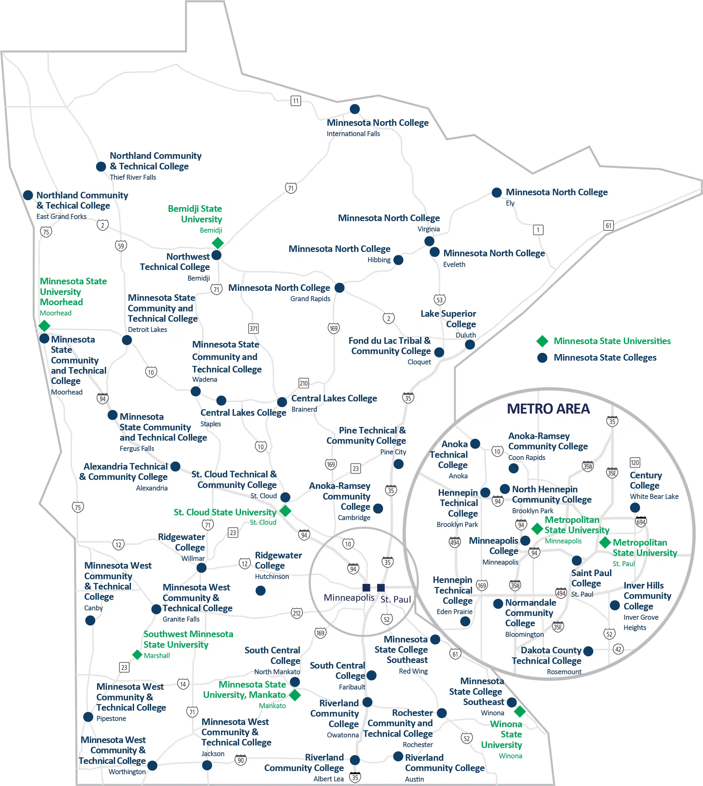
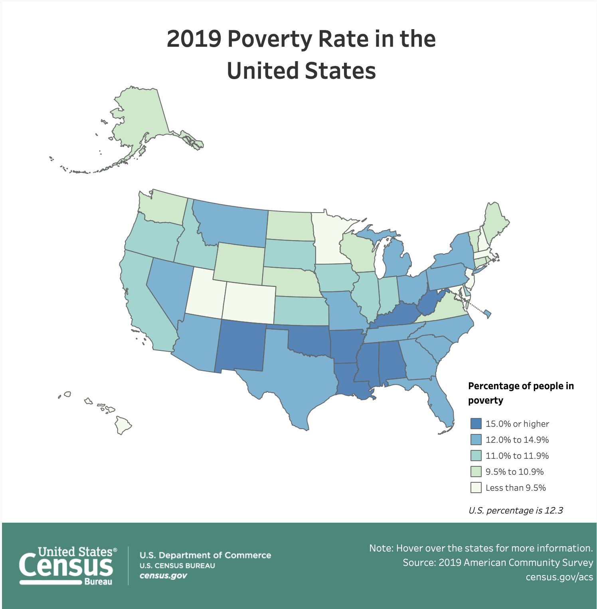
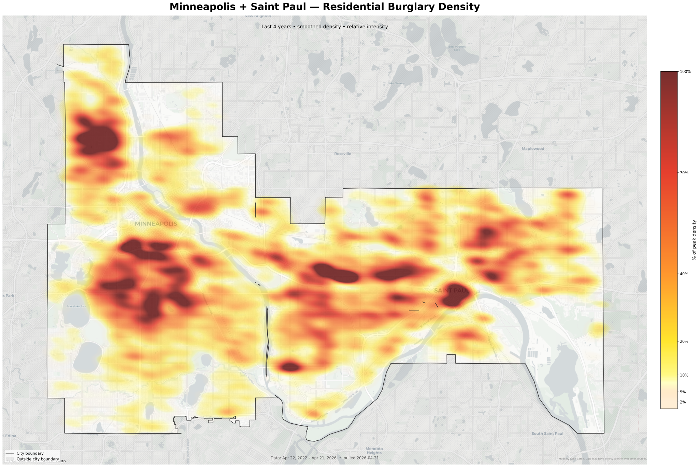

# Visualizations to Address Spatial Relationships

Another common type of research question that gets asked are questions about spatial relationships. For example:

- Where are the most popular amusement parks?
- Are food shelves distributed throughout the county so that all residents have access?
- Are data centers being built in primarily urban or rural areas?

To answer these questions we need *geographic* or *spatial* data. This simply means that we need data that has information about the location of each case. There are several visualizations that are used for plotting geographic data. 

<br />


## Map with Points

One geographic visualization is the map with points. This uses specific markers, dots, or coordinates on a to represent individual locations on a map. For example, @fig-point-map is a map created by [Minnesota State Colleges and Universities](https://www.minnstate.edu/) (MNSCU) to show the location of the 33 public community and technical colleges and state universities in Minnesota.

```{r}
#| label: fig-point-map
#| fig-cap: "Map showing the location of the 33 public community and technical colleges and state universities in Minnesota."
#| fig-alt: "Map showing the location of the 33 public community and technical colleges and state universities in Minnesota."
#| out-width: "80%"
#| echo: false


```

<br />


## Choropleth Map

Another geographic visualization is the choropleth map. A choropleth map is a type of map in which geographic areas are assigned a color in relation to some attribute. @fig-linegraph shows a choropleth map created by the [United States Census Bureau](https://www.census.gov/) to indicate the percentage of each state's population that lives in poverty. 

```{r}
#| label: fig-chorpleth
#| fig-cap: "Choropleth map of the percentage of each state's population that lives in poverty."
#| fig-alt: "Choropleth map of the percentage of each state's population that lives in poverty."
#| out-width: "80%"
#| echo: false


```

<br />


## Intensity Map

Another geographic visualization is the intensity or heat map (also sometimes called a point density map). An intensity map uses a color gradient to show the concentration, frequency, or strength of data across a surface. @fig-intensity-map is an intensity map created by [Colin Catlin](https://syllepsis.live/2026/04/22/a-twin-cities-crime-map/) to show incidents of residential burglary in Minneapolis and St. Paul. Colin created this map to help inform their decision on where to buy a house.


```{r}
#| label: fig-intensity-map
#| fig-cap: "Intensity map showing the incidents of residential burglary in Minnespolis and St. Paul."
#| fig-alt: "Intensity map showing the incidents of residential burglary in Minnespolis and St. Paul."
#| out-width: "80%"
#| echo: false


```

<br />


## Data Story with Maps

The data story with any map is to understand the geographic distribution of data. We can also use maps to make comparisons between geographic areas. For example the data story with the map of colleges in Minnesota might be one of access to higher education  We can see that almost every part of the state has access to a technical or community college. However the four-year universities are primarily located  in the central and southern part of the state (the more populated part of the state), leaving most of the northern part of the state without access to four-year schools.

The data story with the choropleth map of poverty rates might be about the identification of states that are doing "well" or not in relation to the economic welfare of their citizens. Here we see that the states with the highest rates of poverty (15% or higher) are primarily in the south. And almost half of the states in the country have a poverty rate higher than 12%. There are very few states where the poverty rate is under 9.5%. 

The data story with the intensity map might be about where in the Twin Cities are we seeing more or fewer residential burglaries. (The creator of this map scaled the colors based on the 99th percentile of maximum crime; so the scale reflects a relative comparison. They went on to write, "From there, my research suggested 2% of peak crime is 'quiet suburb' crime cap, then the 5%--10% of max is 'some risk but generally one more people would be comfortable with'.") This suggests that most of the places in Minneapolis and St. Paul are relatively safe (i.e., low residential burglary relative to the highest rate). There are, however a few 'hot spots' in both cities. These represent neighborhoods that have the highest levels of residential burglary in the two cities. But, as the creator wrote, "[i]t is very important to remember that comfort depends on 'disorder cues, lighting, vacancy, and familiarity' as much if not more than the actual crime level, so just because an area looks good on a map doesn’t mean...that it 'feels safe' (or vice versa)."

<br />


