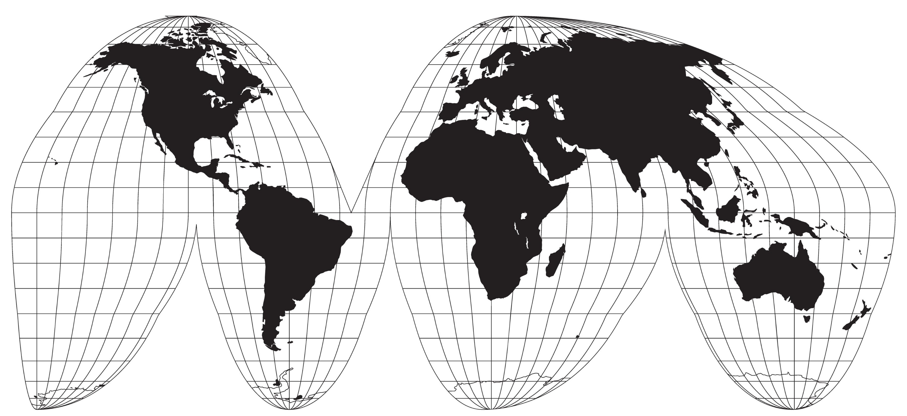
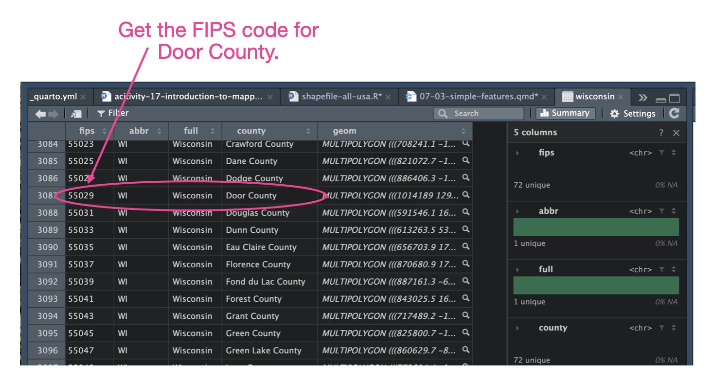

# Introduction to Simple Features Data


<!-- This chapter will focus on the use of shapefiles to create maps in R. To illustrate this, we will use the *banned-books.csv* data. This dataset includes information the number of banned books in each state in the United States from 2021 to 2024.  -->

This chapter will focus on the use of simple features data to create maps in R. To do this we will use the *national-parks.csv* data. This dataset includes information on 61 national parks in the United States.

In addition to loading the `{tidyverse}` library, we will also load the `{usmap}` and `{sf}` libraries. (Note: You may need to install these---check the list of packages in your `Packages` tab to see if you have it installed.)


```{r}
#| label: load-packages2
#| message: false

######################
# Load library
######################

library(ggthemes)
library(usmap)
library(sf)
library(tidyverse)


######################
# Import data
######################

parks <- read_csv("data/national-parks.csv")

# View data
parks
```


Similar to how we previously created a map with points, we need to first create a base map and then add the locations to the base map.

<br />


## Creating a Base Map from A Simple Features Dataset

The `{usmap}` package includes several datasets and functions for creating a map of the United States that includes the states of Alaska and Hawaii, along with Puerto Rico. The key function is `us_map()` This function takes the argument `region=`. To create a state-level map of the United States we will use `region="states"`. We will assign the output of this function into a data object called `my_usa`.

```{r}
# Get shapefile data for the USA map
my_usa = us_map(regions = "states")

# View data
my_usa
```

The header of the data gives you information about the spatial data. The first line (`Simple feature collection with 52 features and 3 fields`) indicates that this is a *simple features* dataset. Simple features (SF) is a set of standards for storing geospatial data. In the geospatial data we saw previously, the data included columns giving the latitude and longitude of different locations. (We call that point data.) In SF data the geospatial information is provided by including a vector of *two-dimensional geometries* for each location. This allows for more complex mapping by expanding from points (which are still possible) to multipoint lines and polygons. 

In the `my_usa` data the `geom` column provides the two-dimensional geometries. Here you can see that each state/territory is a `MULTIPOLYGON`. This is a polygon that is defined by multiple points. (Note: A polygon is a series of points that closes back on itself.) Each state's multipolygon geometry creates a set of connected points that draws the particular state. Since `my_usa` includes the geometry for all the states/territories, we can use this SF dataset to draw our base map.

To plot simple features data we will use the `geom_sf()` layer in our `ggplot2` map. This function is  available in the `{sf}` package. (That is why we loaded that package earlier.) Since we are provide a simple features dataset to the `data=` argument in the `ggplot()` layer, we don't need to provide a mapping with the `aes()` function. To create our base map we can use:


```{r}
# Create base map
ggplot(data = my_usa) +
  geom_sf()
```

We can also use the `theme_map()` layer, from the `{ggthemes}` package, to include nice theme to use with our map.

```{r}
# Create a nice base map
ggplot(data = my_usa) +
  geom_sf() +
  theme_map()
```


<br />


## Adding Points

Now that we have our base map, we need to add the national park locations to the map. You might try something similar to what we did in the last chapter:

```{r}
# Create a nice base map
ggplot(data = my_usa) +
  geom_sf() +
  theme_map() +
  geom_point(data = parks, aes(x = lng, y = lat), color = "darkred")
```

This does not work! You only get a single point. This is because the longitudes and latitudes in the `parks` object use a different coordinate system than our simple features map. 


<br />


### Coordinate Reference Systems (CRS)


The coordinate system is a reference framework used to identify and measure the exact spatial location of features, images, and data on the Earth's surface. The coordinate reference system (CRS) is the underlying mathematical model of the Earth used to create your map. There are two primary systems: Geographic Coordinate Systems (GCS) and Projected Coordinate Systems (PCS)

<br />


#### Geographic Coordinate Systems (GCS)


The longitude and latitude data (as in the `parks` object) use a geographic coordinate system. These systems use a three-dimensional spherical or ellipsoidal surface to map locations. This means the system does not flatten the Earth onto a map. Instead, it leaves the coordinates resting on a curved, three-dimensional mathematical model that mimics the real shape of the planet. In this model, instead of measuring locations in flat grid lines like a checkerboard (X and Y in meters or feet), a GCS measures locations using angles from the center of the Earth---the degrees given in the Latitude and Longitude. 


The GCS system used most commonly is the WGS 84 (*World Geodetic System 1984*) coordinate system. This particular CRS is the native coordinate system used by the global GPS network to give latitude and longitude coordinates. Since we have latitude and longitude for our national parks given in degrees, the CRS for these data is WGS 84.


:::fyi
**FYI: What Exactly are Latitude and Longitude?**

A Geographic Coordinate System (GCS) treats coordinates as angular measurements originating directly from the core of our spherical or ellipsoidal Earth. The system begins at the absolute center of Earth (think of it like the origin point). Now, imagine a flat horizontal sheet slicing the Earth right at the Equator. The Latitude of a specific point is the vertical angle measured upward or downward from that equatorial plane. Next, imagine a vertical sheet slicing the Earth through the Prime Meridian (Greenwich, England). The Longitude is the horizontal angle swept left or right from that starting line.
:::

<br />


#### Projected Coordinate Systems (PCS)


The simple features map we created uses a different coordinate system. It uses a *projected coordinate system* called NAD27. A projected coordinate system is used to project the Earth's curved surface onto a flat, two-dimensional planar surface that makes up our map. We need to use a projected coordinate system because we cannot take a curved surface and make it flat without distorting things or losing accuracy. To understand this, imagine Earth as an orange. If you peel an orange whole and try to press it completely flat onto a table, the peel will rip apart at the edges, or squish and stretch out of shape in the middle. This is illustrated in @fig-earth-orange.

```{r}
#| label: fig-earth-orange
#| fig-cap: "The world after flattening it."
#| fig-alt: "The world after flattening it."
#| echo: false


```

Mapping software assumes that the grid lines (latitudes and longitudes) are perfectly uniform linear distances on our flat maps. In reality, lines of longitude get narrower as you approach the poles. Another issue is that when we map three-dimensional degrees onto a two-dimensional grid, it makes countries look progressively wider and shorter the further north or south they are from the equator. Projections use advanced mathematics to control this inevitable distortion. 

Each projected coordinate system allows you to pick exactly which geometric property—shape, area, or distance—remains 100% accurate and flat for your specific project area, slicing and stretching the map only where it won't impact your analysis. For example, the NAD27 projection (North American Datum of 1927), anchors the map to a single physical location, namely Meades Ranch in Kansas. By doing this it optimizes the accuracy for mapping the United States. 

Google Maps uses the Mercator Projection system to projects the Earth onto a flat, two-dimensional square grid so that map tiles can be seamlessly loaded and navigated on computer screens and mobile devices. It crops the world at exactly 85.0511 degrees North and South latitude. By cutting off the poles, the mathematical projection creates a map that is a perfect square. This cropping preserves local angles and shapes perfectly, meaning that local roads intersect at a 90-degree angle on your screen just as they do in real life, making it highly intuitive for street-level navigation and driving directions.

<br />


### Matching Coordinate Systems

In order to plot our national parks on our simple features map which uses the NAD27 CRS, we need to do two things: (1) turn our parks data into a simple features dataset; and (2) transform the data to use the NAD27 system. 

To convert our longitude and latitude data into a simple features dataset, we will use the `st_as_sf()` function from the `{sf}` package. We need to include the argument `coords=` which gives the names of the longitude and latitude columns (in that order) in a `c()` function. We also specify that the CRS is WGS 84 by including the argument `crs=4326`. (Note: The European Petroleum Survey Group (EPSG), an organization that originally published a standardized registry of spatial reference systems, datums, and coordinate transformations for the oil and gas industry. The value you supply to the `crs=` argument is the EPSG number that corresponds to the CRS. FOr WGS 84 the EPSG number is 4326)


```{r}
# Convert the parks data to a simple features dataset
parks2 = st_as_sf(parks, coords = c("lng", "lat"), crs = 4326)

# View data
parks2
```

Looking at the object that includes the transformed data, we can see that it has been transformed into a simple features dataset. The `geometry` column indicates that each geometric feature is a POINT. You can also see that the CRS is using WGS 84.

Next, we will transform the CRS for the parks simple features data to NAD27. To do this we will use the `st_transform()` function. We provide this function the name of the simple features data we want to change the CRS for and the argument `crs=` giving the EPSG for the new CRS. The value for NAD27 is 9311.


```{r}
# Transform latitudes and longitudes to NAD27
parks_nad27 = st_transform(parks2, crs = 9311)

# View transformed data
parks_nad27 
```


From the header metadata, you can now see that the CRS for this simple features dataset is now NAD27. We can now plot the national parks using another `geom_sf()` layer.


```{r}
# Create a nice base map
ggplot(data = my_usa) +
  geom_sf() +
  theme_map() +
  geom_sf(data = parks_nad27, color = "darkred")
```


<br />


### PROTIP: Obtaining the EPSG Number for a Simple Features Dataset

If you don't know the EPSG number for the CRS, you can obtain it from the simple features data you use to create the base map using the `st_crs()` function. For example,

```{r}
# Get CRS Info
st_crs(my_usa)
```

The last line of this output indicates that the EPSG number is 9311.


<br />


## Obtaining Other Maps From `us_maps()`

Aside from the state map of the United States, we can also use the `us_map()` function to obtain simple features data for many other U.S. centric maps. For example instead of `regions = "states"`, we can use `regions = "counties"` to obtain a county-level map of the U.S.

```{r}
#| label: fig-usa-counties
#| fig-cap: "A county-level map of the USA."
#| fig-alt: "A county-level map of the USA."

# Obtain county-level data
us_counties = us_map(regions = "counties")

# View data
us_counties

# Plot map
ggplot(data = us_counties) +
  geom_sf() +
  theme_map()
```

We can also get a map of a specific state by including the argument `include=` in the `us_map()` function, in addition to the `region=` argument. This argument takes either a state name, two-letter abbreviation, or FIPS code.

```{r}
#| label: fig-wisconsin
#| fig-cap: "A map of the Wisconsin."
#| fig-alt: "A map of the Wisconsin."

# Obtain county-level data
wisconsin = us_map(regions = "states", include = "WI")

# View data
wisconsin

# Plot map
ggplot(data = wisconsin) +
  geom_sf() +
  theme_map()
```

If you want just the state with the counties, use `region="counties"`.

```{r}
#| label: fig-wisconsin-counties
#| fig-cap: "A county-level map of the Wisconsin."
#| fig-alt: "A county-level map of the Wisconsin."

# Obtain county-level data
wisconsin = us_map(regions = "counties", include = "WI")

# View data
wisconsin

# Plot map
ggplot(data = wisconsin) +
  geom_sf() +
  theme_map()
```

Lastly, we can create a map for a particular county by using `region="counties"` and providing the county FIPS code in the `include=` argument. For example, say we wanted to create a map of Door County in Wisconsin. To do this we can examine the Wisconsin county-level data and make a note of the FIPS code---in this case Door County's FIPS code is 55029.

```{r}
#| label: fig-find-fips
#| fig-cap: "Finding the FIPS code for Door County."
#| fig-alt: "Finding the FIPS code for Door County."
#| echo: false


```

We then create a Door County dataset by using `include="55029"`.


```{r}
#| label: fig-door-county
#| fig-cap: "A map of Door County in Wisconsin."
#| fig-alt: "A map of Door County in Wisconsin."

# Obtain Door County data
door_county = us_map(regions = "counties", include = "55029")


# View data
door_county

# Plot map
ggplot(data = door_county) +
  geom_sf() +
  theme_map()
```


<br />


