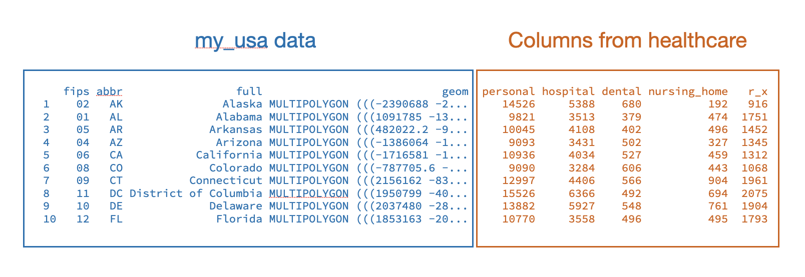

# Choropleth Maps

This chapter will focus on the use of simple features data to create a choropleth map in R. To do this we will use the *health-care.csv* data. This dataset includes information on the per-capita health care spending in the United States. We will also create the simple features dataset that we will use to create our base map.


```{r}
#| label: load-packages2
#| message: false

######################
# Load library
######################

library(ggthemes)
library(usmap)
library(scales)
library(sf)
library(tidyverse)


######################
# Import data
######################

healthcare = read_csv("data/health-care.csv")

# View data
healthcare


######################
# Set up simple features data for basemap
######################

my_usa = us_map(regions = "states")

```


<!-- Similar to how we previously created a map with points, we need to first create a base map and then add the locations to the base map. -->

<br />


## What is a Choropleth Map?

A choropleth map is a type of thematic map where geographic regions (such as countries, states, or counties) are shaded, colored, or patterned to show how a specific data variable changes across that area. Choropleth maps typically assign different colors or intensity gradients (such as light-to-dark shades) to represent high or low values. 

@fig-healthcare shows a choropleth map of the per-capita personal healthcare spending in 2022 by state.


```{r}
#| label: fig-healthcare
#| fig-cap: "Per-capita personal healthcare spending in 2022 for each state. The average amount spent in the United States is $10,714."
#| fig-alt: "Per-capita personal healthcare spending in 2022 for each state. The average amount spent in the United States is $10,714."
#| out-width: "100%"
#| echo: false

# Get shapefile data for the USA map
my_usa = us_map(regions = "states")

# Create map
my_usa |>
  left_join(healthcare, by = "abbr") |>
  ggplot() +
  geom_sf(aes(fill = personal)) +
  theme_map() +
  scale_fill_gradientn(
    name = "PER-CAPITA SPENDING",
    colors = c("#fef001", "#f77a05", "#f00505"),
    breaks = c(8000, 12000, 16000),
    limits = c(8000, 16000),
    labels = scales::label_dollar()
  ) +
  theme(
    legend.position = "top",
    legend.direction = "horizontal",
    legend.key.width = unit(0.9, "null"),
    legend.margin = margin(l = 0.15, r = 0.10, unit = "npc"),        # Remove bounding margins
    legend.box.margin = margin(0, 0, 0, 0)
  ) +
  guides(fill = guide_colorbar(title.position = "top", title.hjust = 0.5))
```


:::fyi
**IMPORTANT**

When you create a choropleth map, it is important to use rates, percentages, proportions, or per-capita numbers (like unemployment rates or population density) rather than raw counts. Raw totals can be misleading because larger regions naturally look bigger and produce larger numbers (e.g., California will look higher than Rhode Island because there are more people who live in California). By converting raw counts to rates you get a more accurate interpretation of the information being mapped.
:::


<br />


## Merging the Value Data with the Simple Features Data

To create a choropleth map, we need to merge the data that includes the information we want to color on the map (e.g., the data in the `healthcare` object) with the data we will be using to create our base map (e.g., the data in the `my_usa` object. Essentially we want to take the data in `my_usa` and add the columns from the `healthcare` data to it by matching on the state.

```{r}
#| label: fig-merged-data
#| fig-cap: "The merged data would add the columns from the healthcare data into the simple features data based on state."
#| fig-alt: "The merged data would add the columns from the healthcare data into the simple features data based on state."
#| echo: false


```

Merging two datasets is called *joining* and we will use the `left_join()` function to join the datasets together. This function takes three arguments:

- The name of the simple features data object that you want to merge into (`my_usa`).
- The name of the data object wou will be merging in (`healthcare`)
- The name of the key column given in the `by=` argument.

A key is a common column shared by two or more datasets that acts as a matching point to connect or combine records. It needs to have the exact same name in both datasets. In our two datasets we have the following columns:


::: {.columns}

::: {.column width="50%"}
`my_usa` Simple Features Dataset

- `fips`
- `abbr`
- `full`
- `geom`
:::

::: {.column width="50%"}
`healthcare` Dataset

- `state`
- `abbr`
- `personal`
- `hospital`
- `dental`
- `nursing_home`
- `r_x`
:::

:::


The key column we will use to merge these two datasets is `abbr`. This will match up rows based on the values in `abbr`. For example the data in `my_usa` that has an `abbr` value of "MN" will be matched up with the data in `healthcare` that also has an `abbr` value of "MN". The syntax to merge these two datasets is:

```{r}
######################
# Merge the two datasets
######################

my_usa_healthcare = left_join(my_usa, healthcare, by = "abbr")

# View data
my_usa_healthcare
```


<br />


## Create the Choropleth Map

To create the choropleth map, we will create our base map and then fill the states based on the `personal` column. Since `personal` is a column in the dataset, we map it to `fill=` inside of an `aes()` function.


```{r}
#| fig-alt: "Choropleth map of per-capita spending on personal healthcare by state."

######################
# Create choropleth map
######################

ggplot(data = my_usa_healthcare) +
  geom_sf(aes(fill = personal)) +
  theme_map()
```

Usually darker colors correspond to higher values of the data being plotted. In our legend, we can see that the higher values are lighter in color. We would normally change this by including a `scale_fill_gradient()` layer. But, I also want to change the color gradient from the current blue palette to a yellow--orange--red palette. Because we have more than two specified colors we will use `scale_fill_gradientn()` to change the palette.

Within this layer I specify the color values using `color=` and putting the three color values in a `c()` function. I also specify that I want those colors to occur at \$8000 (approximately the minimum value), \$12000, and \$16000 (approximately the maximum value). The `limits=` gives the min and max values on the color scale. Finally, we add "$" using the argument `labels=label_dollars()`.

```{r}
#| fig-alt: "Chorpleth map of per-capita spending on personal healthcare by state. The fill gradient has been changed to a yellow--orange--red palette."

######################
# Create choropleth map
######################

ggplot(data = my_usa_healthcare) +
  geom_sf(aes(fill = personal)) +
  theme_map()  +
  scale_fill_gradientn(
    name = "PER-CAPITA SPENDING",
    colors = c("#fef001", "#f77a05", "#f00505"),
    # Align these values with the yellow, orange, and red parts of the colorbar
    breaks = c(8000, 12000, 16000),
    # Set the minimum and maximum values of the colorbar
    limits = c(8000, 16000),
    # Add '$' to the labels in the legend
    labels = label_dollar()
  )
```


Next, we will move the legend to the top of the plot. To do this we use the `theme()` and `guides()` layers.


```{r}
#| fig-alt: "Chorpleth map of per-capita spending on personal healthcare by state. The fill gradient has been changed to a yellow--orange--red palette. The legend is moved to the top of the plot."

######################
# Create choropleth map
######################

ggplot(data = my_usa_healthcare) +
  geom_sf(aes(fill = personal)) +
  theme_map()  +
  scale_fill_gradientn(
    name = "PER-CAPITA SPENDING",
    colors = c("#fef001", "#f77a05", "#f00505"),
    # Align these values with the yellow, orange, and red parts of the colorbar
    breaks = c(8000, 12000, 16000),
    # Set the minimum and maximum values of the colorbar
    limits = c(8000, 16000),
    # Add '$' to the labels in the legend
    labels = label_dollar()
  ) +
  theme(
    # Move the legend to the top
    legend.position = "top",
    # Have the colorbar go horizontal rather than vertical
    legend.direction = "horizontal",
    # Allow the legend to expand to the size of the whole plot
    legend.key.width = unit(1, "null"),
    # Set the left and right margins to have some whitespace around the legend
    legend.margin = margin(l = 0.15, r = 0.10, unit = "npc")
  ) +
  guides(
    fill = guide_colorbar(
      # Add the title of the legend over the colorbar
      title.position = "top", 
      # Center the title over the colorbar
      title.hjust = 0.5
      )
    )
```


Finally, we can add a title, subtitle, and caption to the plot to finish it off. Since the title now gives us the same information as the legend, we also omit the legend title. Because the `guides()` layer only changes the positioning of the legend title, we can also remove it.


```{r}
#| fig-alt: "Chorpleth map of per-capita spending on personal healthcare by state. The fill gradient has been changed to a yellow--orange--red palette. The legend is moved to the top of the plot. Titles have also been added"

######################
# Create choropleth map
######################

ggplot(data = my_usa_healthcare) +
  geom_sf(aes(fill = personal)) +
  theme_map()  +
  scale_fill_gradientn(
    name = "",
    colors = c("#fef001", "#f77a05", "#f00505"),
    # Align these values with the yellow, orange, and red parts of the colorbar
    breaks = c(8000, 12000, 16000),
    # Set the minimum and maximum values of the colorbar
    limits = c(8000, 16000),
    # Add '$' to the labels in the legend
    labels = label_dollar()
  ) +
  theme(
    # Move the legend to the top
    legend.position = "top",
    # Have the colorbar go horizontal rather than vertical
    legend.direction = "horizontal",
    # Allow the legend to expand to the size of the whole plot
    legend.key.width = unit(1, "null"),
    # Set the left and right margins to have some whitespace around the legend
    legend.margin = margin(l = 0.15, r = 0.10, unit = "npc")
  ) +
  labs(
    title = "PER-CAPITA SPENDING ON PERSONAL HEALTHCARE BY STATE",
    subtitle = "The average per-capita spending on personal healthcare in the United States is $10,714.\n\n",
    caption = "SOURCE: Altarum"
  )
```


The map shows a lot of variability in how much per-capita that states spent on personal healthcare in 2022. Washington, D.C., New York, and Alaska recorded the highest per-capita spending, while Idaho, Nevada, and Utah spent the least. In general, states in the southwest and southern part of the US spend less than other states, while those on the west coast and in the northeast spend more. Much of the variation likely reflects differences in health care prices, provider availability, and demographics.


<br />


## County-Level Choropleth

To see how to build a county-level choropleth map we will plot the early childhood vaccination rates by county for the state of Minnesota. To do this we will import the *vaccine-rates-mn-2023.csv* data into R. We will also obtain the simple features dataset for counties in Minnesota. 


```{r}
######################
# Import data
######################

vaccine = read_csv("data/vaccine-rates-mn-2023.csv")

# View data
vaccine


######################
# Get simple features data for Minnesota basemap
######################

mn = us_map(regions = "counties", include = "MN")

# View data
mn
```

Looking at the two datasets, we can use the `county` column as our key to merge the two datasets.


```{r}
# Join geospatial and vaccine data
mn2 = left_join(mn, vaccine, by = "county")

# View data
mn2
```


Now we will create a choropleth map. 


```{r}
#| fig-alt: "Chorpleth map of early childhood vaccine rates in MN. The fill gradient has been changed to a yellow--green--blue palette. The legend is moved to the top of the plot. Titles have also been added"
#| out-width: "100%"

######################
# Create choropleth map
######################

ggplot(data = mn2) +
  geom_sf(aes(fill = child_series)) +
  theme_map()  +
  scale_fill_gradientn(
    name = "",
    colors = c("#edf8b1", "#7fcdbb", "#2c7fb8"),
    # Align these values with the yellow, orange, and red parts of the colorbar
    breaks = c(0, 50, 100),
    # Set the minimum and maximum values of the colorbar
    limits = c(0, 100),
    # Add '%' to the labels in the legend; don't multiply by 100
    labels = label_percent(scale = 1)
  ) +
  theme(
    # Move the legend to the top
    legend.position = "top",
    # Have the colorbar go horizontal rather than vertical
    legend.direction = "horizontal",
    # Allow the legend to expand to the size of the whole plot
    legend.key.width = unit(1, "null"),
    # Set the left and right margins to have some whitespace around the legend
    legend.margin = margin(l = 0.05, r = 0.05, unit = "npc")
  ) +
  labs(
    title = "2023 EARLY CHILDHOOD VACCINE RATES",
    subtitle = "The state-level vaccine rate for early childhood vaccines is 70.6%.\n\n",
    caption = "SOURCE: Minnesota Department of Health"
  ) 
```

Because of the NAD27 projection used, Minnesota appears tilted when we plot it alone. To make it sit flat, we need to change the projection to one that centers Minnesota. The NAD83 Minnesota Central Projection (which has an EPSG code of 29992) can be used to "untilt" Minnesota so it sits flat. We can set this in the `coord_sf()` layer by using the argument `crs=26992`.


```{r}
#| fig-alt: "Chorpleth map of early childhood vaccine rates in MN. The fill gradient has been changed to a yellow--green--blue palette. The legend is moved to the top of the plot. Titles have also been added"
#| out-width: "100%"

######################
# Create choropleth map
######################

ggplot(data = mn2) +
  geom_sf(aes(fill = child_series)) +
  theme_map()  +
  scale_fill_gradientn(
    name = "",
    colors = c("#edf8b1", "#7fcdbb", "#2c7fb8"),
    # Align these values with the yellow, orange, and red parts of the colorbar
    breaks = c(0, 50, 100),
    # Set the minimum and maximum values of the colorbar
    limits = c(0, 100),
    # Add '%' to the labels in the legend; don't multiply by 100
    labels = label_percent(scale = 1)
  ) +
  theme(
    # Move the legend to the top
    legend.position = "top",
    # Have the colorbar go horizontal rather than vertical
    legend.direction = "horizontal",
    # Allow the legend to expand to the size of the whole plot
    legend.key.width = unit(1, "null"),
    # Set the left and right margins to have some whitespace around the legend
    legend.margin = margin(l = 0.05, r = 0.05, unit = "npc")
  ) +
  labs(
    title = "2023 EARLY CHILDHOOD VACCINE RATES",
    subtitle = "The state-level vaccine rate for early childhood vaccines is 70.6%.\n\n",
    caption = "SOURCE: Minnesota Department of Health"
  ) +
  # Change projection to have Minnesota sit flat
  coord_sf(crs = 26992)
```


One improvement that would help readers better interpret the map is to add the vaccine rate for each county on the map. To do this we need an *x*- and *y*-coordinate where we want the text to be placed for each county. One good location is the *centroid* of each polygon. The `st_centroid()` function computes the centroid for each of the polygons in the simple features data.


```{r}
######################
# Compute centroid
######################

center_mn = st_centroid(mn2)

# View data
center_mn
```


Then we can use the `geom_sf_text()` layer to add text to our simple features map.


```{r}
#| fig-alt: "Chorpleth map of early childhood vaccine rates in MN. The fill gradient has been changed to a yellow--green--blue palette. The legend is moved to the top of the plot. Titles and labels for each county have also been added. "
#| out-width: "100%"

######################
# Create choropleth map
######################

ggplot(data = mn2) +
  geom_sf(aes(fill = child_series)) +
  theme_map()  +
  scale_fill_gradientn(
    name = "",
    colors = c("#edf8b1", "#7fcdbb", "#2c7fb8"),
    # Align these values with the yellow, orange, and red parts of the colorbar
    breaks = c(0, 50, 100),
    # Set the minimum and maximum values of the colorbar
    limits = c(0, 100),
    # Add '%' to the labels in the legend; don't multiply by 100
    labels = label_percent(scale = 1)
  ) +
  theme(
    # Move the legend to the top
    legend.position = "top",
    # Have the colorbar go horizontal rather than vertical
    legend.direction = "horizontal",
    # Allow the legend to expand to the size of the whole plot
    legend.key.width = unit(1, "null"),
    # Set the left and right margins to have some whitespace around the legend
    legend.margin = margin(l = 0.05, r = 0.05, unit = "npc")
  ) +
  labs(
    title = "2023 EARLY CHILDHOOD VACCINE RATES",
    subtitle = "The state-level vaccine rate for early childhood vaccines is 70.6%.\n\n",
    caption = "SOURCE: Minnesota Department of Health"
  ) +
  # Change projection to have Minnesota sit flat
  coord_sf(crs = 26992) +
  # Add text labels at the centroid of each county
  geom_sf_text(data = center_mn, aes(label = child_series), size = 2)
```

The vaccination rates in most counties is pretty high (most are darker colors). Of the 87 counties in Minnesota, 46 are below the state average of 70.6%. These counties range between 36.4% and 70.4%. (The two counties with vaccination rates below 50% are Clay and Wilken county.) Counties that have lower vaccination rates tend to be in the north central and north western parts of the state. 


<br />


