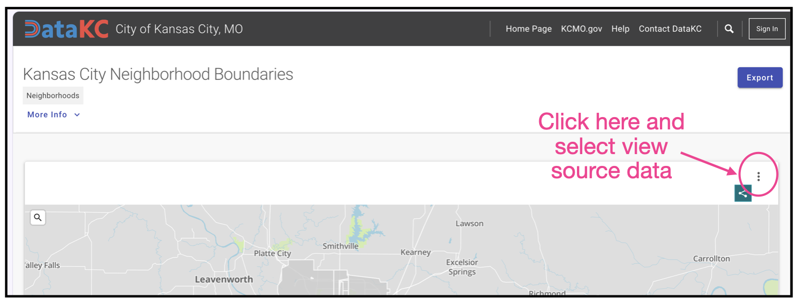
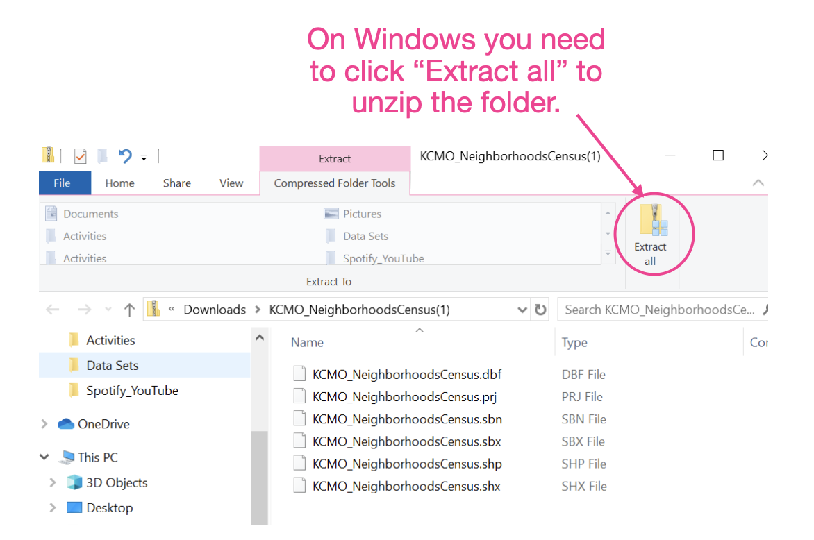

# Introduction to Mapping from Shapefiles


This chapter will focus on the use of shapefiles to create maps in R. To do this we will use the Open City data from Kansas City to create our base map. We will also use the *kc-fountains.csv* data which includes geospatial data on the location of several fountains in Kansas City. FYI: Kansas City is known as the "City of Fountains" and features over 200 registered fountains across the metropolitan area, more than almost any other city in the world. 


```{r}
#| warning: false
#| message: false


######################
# Load libraries
######################

library(ggthemes)
library(sf)
library(tidyverse)


######################
# Import data
######################

kc_fountains = read_csv("data/kc-fountains.csv")

# View data
kc_fountains
```


<br />


## Downloading a ZIP of Shapefile Data


We are going to create our base map of Kansas City from shapefile data. Kansas City, like many cities has an [Open City website](https://data.kcmo.org/), which makes much of its data easily accessible and downloadable. One of the sources of map data they make available is the [Kansas City Neighborhood Boundaries](https://data.kcmo.org/Neighborhoods/Kansas-City-Neighborhood-Boundaries/q45j-ejyk).

- Open the [Kansas City Neighborhood Boundaries](https://data.kcmo.org/Neighborhoods/Kansas-City-Neighborhood-Boundaries/q45j-ejyk) website
- Click on the three vertical dots (right side of the page) and select "view source data".

```{r}
#| label: fig-kc-website
#| fig-cap: "Click on the three dots and select view source data."
#| fig-alt: "Click on the three dots and select view source data."
#| echo: false


```


- Click on the file "KCMO_NeighborhoodCensus.zip". This should download a ZIP folder to your computer. 
- Extract the contents of the ZIP file. To do this double-click on the ZIP file. If you are on a Mac it will create another folder that is unzipped. If you are on a Windows machione, you need to click "Extract All"

```{r}
#| label: fig-extract
#| fig-cap: "On a Windows computer you need to click 'Extract all' to unzip the folder."
#| fig-alt: "On a Windows computer you need to click 'Extract all' to unzip the folder."
#| echo: false


```

<br />


## What is a Shapefile?

A shapefile is a digital vector storage format used in Geographic Information Systems (GIS) to store the location, shape, and attributes of geographic features. This format was developed and popularized by Esri (a global market leader in geographic information system software) in the early 1990s. The shapefile is not one single file, but a collection of files that are stored in the same directory/folder. To work properly, these files must stay together. Here are some of the files in the folder:

- **.shp**: Stores the actual geometric shape and coordinate data.
- **.shx**: Stores the index position of the geometry for fast searching.
- **.sbn**: Optional spatial index file that works to optimize how geographic data is processed
- **.sbx**: Spatial index extension file that works with the .sbn file to optimize how geographic data is processed
- **.dbf**: Stores attribute data (such as names, values, or IDs) in a dBASE format table.
- **.prj** (often included): Stores the coordinate reference system and projection information

<br />


## Importing the SHP File into R

We need to import the .shp file into R since it includes the actual geometric shape and coordinate data. To do this we will use the `st_read()` function from the `{sf}` package. We use this just like `read_csv()`, providing the file path of the .shp file.

```{r}
#| message: false

######################
# Import data
######################

kc = st_read("data/KCMO_NeighborhoodsCensus/KCMO_NeighborhoodsCensus.shp")

# View data
kc
```


Once we import the .shp into R, it is a simple features dataset and we can map with it the same as we did previously.

```{r}
######################
# Create map
######################

ggplot(data = kc) +
  geom_sf(fill = "lightgrey") +
  theme_map()
```


After creating our base map, we can add fountain locations. First we use the `st_crs()` function to get the coordinate system for the Kansas City map.


```{r}
# Get CRS for the kc base map data
st_crs(kc)
```


Then we can transform the fountain data into a simple features data set using this coordinate system.

```{r}
# Transform latitudes and longitudes to WGS 84
fountains_wgs84 = st_as_sf(kc_fountains, coords = c("longitude", "latitude"), crs = 4326)

# View data
fountains_wgs84
```


Finally, we can plot the fountain locations on our map.


```{r}
######################
# Create map
######################

ggplot(data = kc) +
  geom_sf(fill = "lightgrey") +
  theme_map() +
  geom_sf(data = fountains_wgs84, color = "darkred") +
  labs(
    title = "KANSAS CITY FOUNTAINS",
    subtitle = "Location of 94 fountains in Kansas City.\n\n",
    caption = "SOURCE: Open Data Kansas City"
  )
```


Kansas City is known as the "City of Fountains" and features many fountains across the metropolitan area. Most of the fountains are in the center part of the city (e.g., Historic NE, Crossroads, Midtown, Westport).

<br />


## Adding Images to a Plot

We can. also add an image to a plot. To do this, the image needs to be saved on your computer as a PNG file. Here we have previously downloaded an image of the Fountain of Bacchus called *kc-fountain-bacchus.png*.


We will then use load the `{png}` library. (You may need to install it first.) Then we use the `readPNG()` function to import the PNG image into R. This function takes the path name to your PNG file (find it using `file.choose()`) and the argument `native=TRUE`. This keeps the image in its native raster representation (i.e., as an image).


```{r}
######################
# Load library
######################

library(png)


######################
# Import PNG image
######################

fountain_pic = readPNG("figs/kc-fountain-bacchus.png", native = TRUE)
```


To add the image to our map, we include the `annotation_raster()` layer in our map syntax. This function takes the name of the imported PNG, and the four arguments:

- `xmin=`
- `xmax=`
- `ymin=`
- `ymax=`


These arguments take the map coordinates that will define where the image is placed. For example, here we place our foiuntain picture betwwen the coordinates (-94.75, 39.05) and (-94.65, 39.15). 

```{r}
#| fig-alt: "Map of fountains in Kansas City with an image added."

######################
# Create map and add image
######################

ggplot(data = kc) +
  geom_sf(fill = "lightgrey") +
  #theme_map() +
  geom_sf(data = fountains_wgs84, color = "darkred") +
  labs(
    title = "KANSAS CITY FOUNTAINS",
    subtitle = "Location of 94 fountains in Kansas City.\n\n",
    caption = "SOURCE: Open Data Kansas City"
  ) +
  # Insert image
  annotation_raster(fountain_pic, xmin = -94.75, xmax = -94.65, ymin = 39.05, ymax = 39.15)
```

Lastly, we add a text annotation to identify the fountain in the image.


```{r}
#| fig-alt: "Map of fountains in Kansas City with an image and caption for the image added."
#| fig-width: 6
#| fig-height: 10
#| out-width: "100%"

######################
# Create map and add image
######################

ggplot(data = kc) +
  geom_sf(fill = "lightgrey") +
  #theme_map() +
  geom_sf(data = fountains_wgs84, color = "darkred") +
  labs(
    title = "KANSAS CITY FOUNTAINS",
    subtitle = "Location of 94 fountains in Kansas City.\n\n",
    caption = "SOURCE: Open Data Kansas City"
  ) +
  # Insert image
  annotation_raster(fountain_pic, xmin = -94.75, xmax = -94.65, ymin = 39.05, ymax = 39.15) +
  # Add text to plot
  annotate("text", x = -94.7, y = 39.03, label = "Fountain of\nBacchus", size = 3) 
```


<br />


